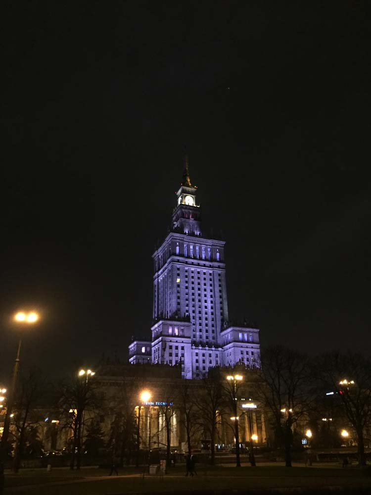
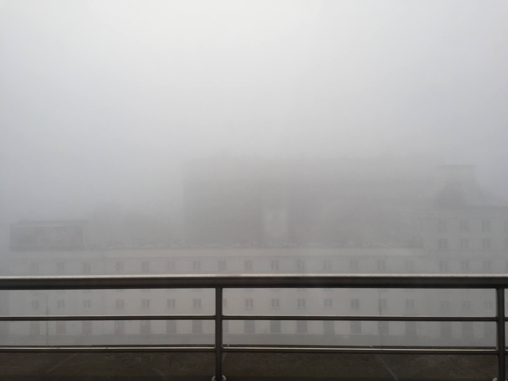
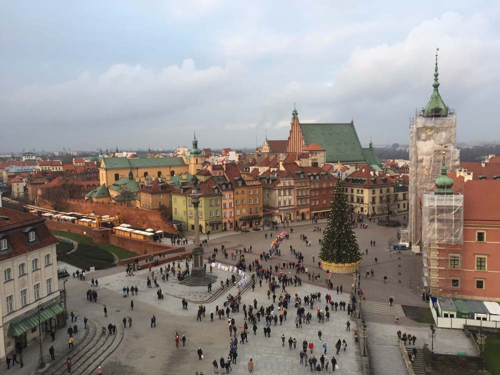
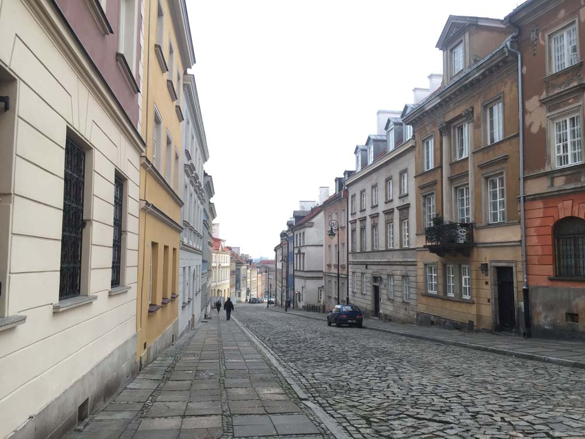
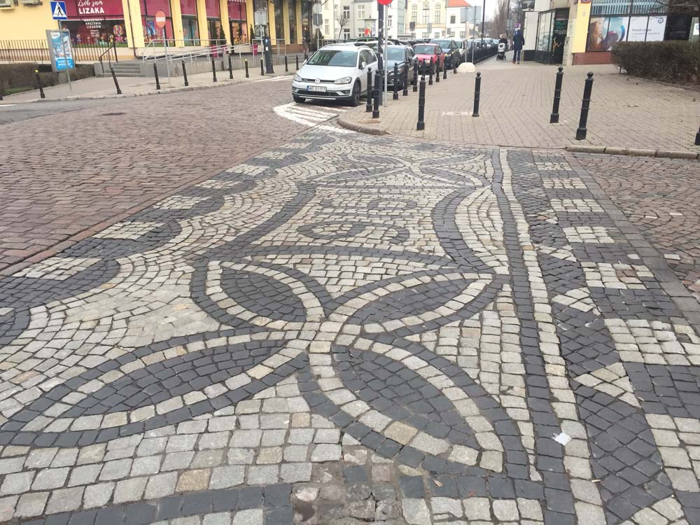
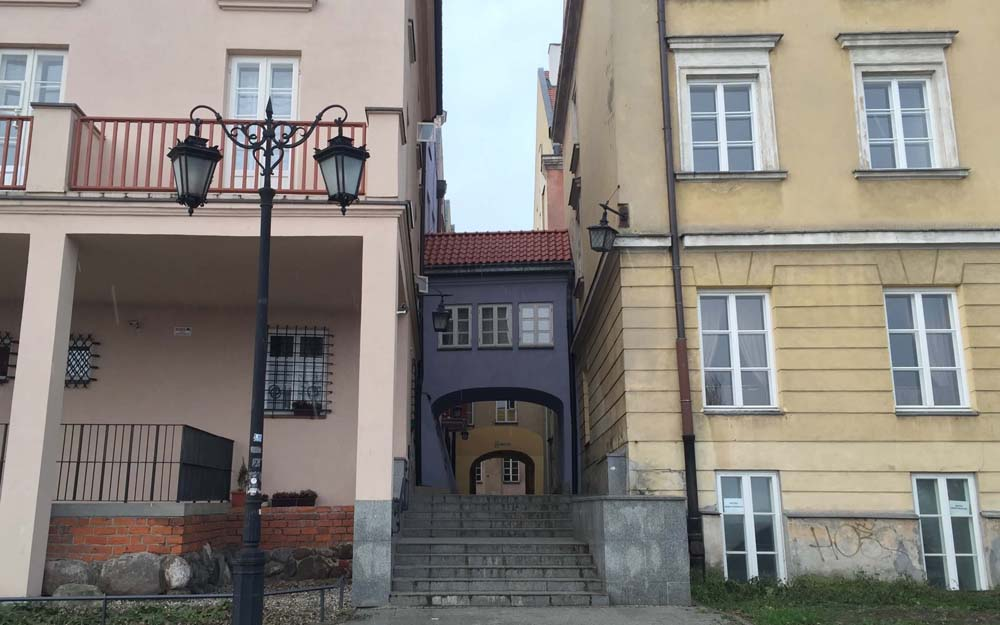
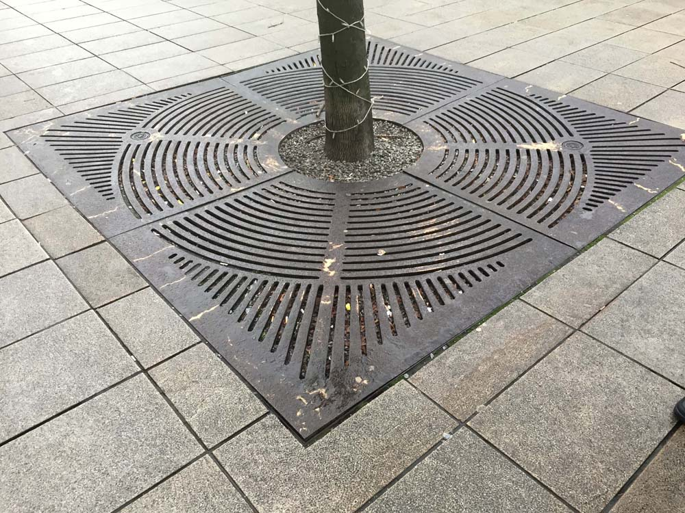
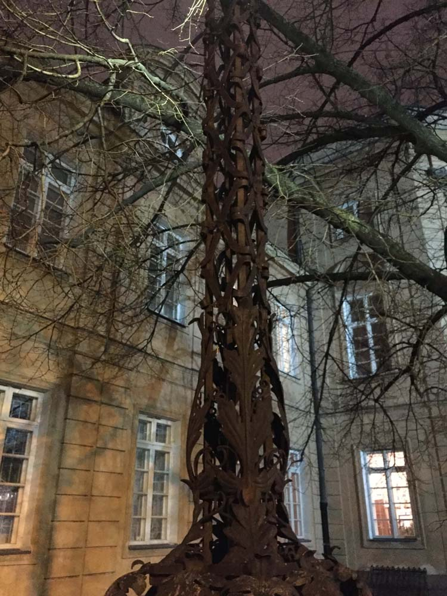
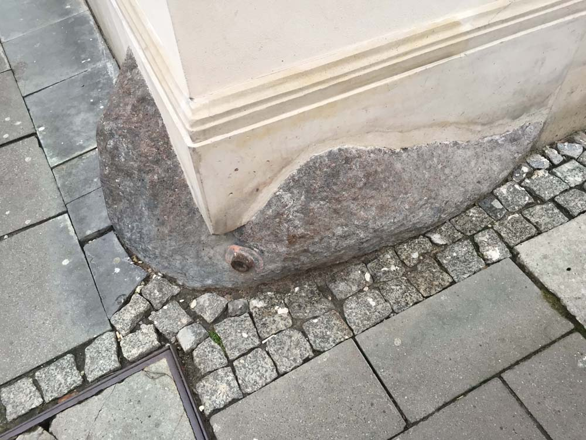

Если выйти на центральной станции, то сразу видно Palace of Culture and Science.

{loading=lazy width="750" height="1000"}

Сейчас там куча учреждений, есть университет и даже кинотеатр. Внутри здание выглядит довольно потрепанным, есть старый лифт с лифтером, который поднимет тебя до смотровой площадки. В лифте душно, стоит вентилятор.

Над городом стоял туман:

{loading=lazy width="3264" height="2448"}

Центр милый и красочный:

{loading=lazy width="1000" height="750"}

{loading=lazy width="1000" height="750"}

Я еще никогда не видела таких прекрасных переходов:

{loading=lazy width="1000" height="750"}

Часто попадаются арки:

{loading=lazy width="1000" height="625"}

У деревьев идеальные приствольные решетки:

{loading=lazy width="1000" height="750"}

А у фонарей цоколи:

{loading=lazy width="750" height="1000"}

Углы домов налезают на камни:

{loading=lazy width="1000" height="750"}

Еще в Варшаве есть замечательный музей Коперника. В нем множество физических экспериментов, все можно потрогать и попробовать провести опыт самому.
